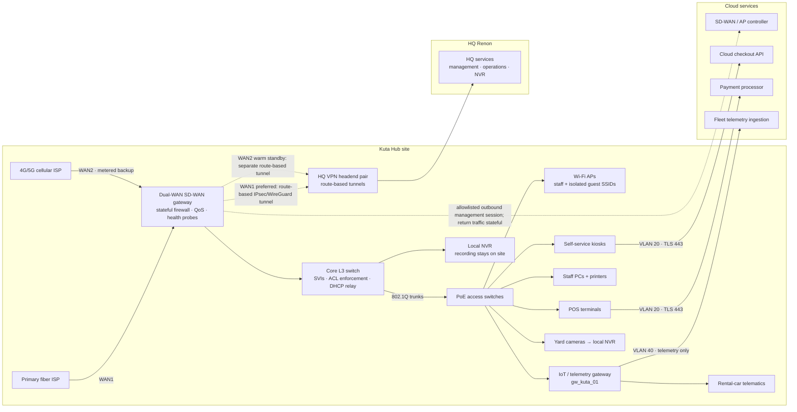

# Kuta Hub Network Architecture

## 1. Topology

The Kuta Hub gateway terminates the two local WAN circuits and builds an independently monitored overlay tunnel to HQ Renon on each circuit. The WAN1 tunnel is preferred; the WAN2 tunnel is kept established with keepalives so a route change does not wait for a full negotiation. The cloud controller manages the SD-WAN policy and AP configuration, while checkout traffic reaches a separately allowlisted cloud checkout API.



**Tunnel and switching details.** Use route-based IKEv2/IPsec (or WireGuard where both ends are managed) with separate tunnel interfaces and health state per WAN. The Kuta gateway initiates both tunnels; this supports cellular providers using CGNAT. Enable persistent keepalives/DPD, use unique tunnel addresses, and advertise only the Kuta site prefixes. WAN1 has the preferred route; WAN2 has a tracked higher preference until WAN1 fails. The L3 switch hosts the VLAN SVIs and DHCP relay. Apply ACLs on every SVI and matching stateful policy on the WAN firewall; do not use a trunk/native VLAN as a security boundary. Carry user VLANs tagged on switch trunks, use an unused native VLAN, and disable unused switch ports.

### ASCII fallback

```text
                          +----------------------- Cloud ----------------------+
                          | SD-WAN/AP controller | Checkout API | Payment | IoT |
                          +----------^-----------+-------^-------^--------^-----+
                                     | mgmt egress        |       |        |
  Fiber ISP ---- WAN1 ----+          |                   VLAN20  VLAN20   VLAN40
                          |   +------+---------------------+-------------------+
  4G/5G ISP --- WAN2 -----+-->| Dual-WAN gateway / firewall / QoS               |
                              | WAN1 preferred; WAN2 warm tunnel standby         |
                              +----------------------+---------------------------+
                                                     | 802.1Q trunks
                                      +--------------v--------------+
                                      | Core L3 switch (SVIs + ACLs) |
                                      +--------------+--------------+
                                                     | PoE access switches
          +-------------------+----------------------+--------------------+
          |                   |                      |                    |
       APs/SSIDs          Kiosks + POS          Staff PCs/printers   gw_kuta_01
       VLAN 30/50         VLAN 20               VLAN 30              VLAN 40
                                                                       |      |
                                                                    Cars   Cameras
                                                                             |
                                                               Local cameras -> NVR

  Gateway == route-based tunnel over WAN1 ==> HQ Renon VPN headend
  Gateway == warm route-based tunnel over WAN2 ==> HQ Renon VPN headend
  HQ services: management, operations, NVR
```

## 2. 802.1Q VLAN matrix

The gateway/SVI address is `.1` in each subnet. The core L3 switch routes only where an explicit rule below permits it; its implicit inter-VLAN policy is deny. DHCP is served by the local gateway or relayed to the named local service as appropriate. DNS and time for restricted segments are provided by approved HQ services or fixed local infrastructure, not an unrestricted public resolver.

| VLAN ID | Name | Subnet | Gateway IP | DHCP scope (range, lease, reservations/static) | DSCP marking + queue | Allowed inter-VLAN flows | Internet access |
|---:|---|---|---|---|---|---|---|
| 10 | Management | `10.10.10.0/24` | `10.10.10.1` | Reservation pool `10.10.10.100–10.10.10.149`, 7-day lease; switches, APs, gateway and controller-facing infrastructure use static addresses in `.2–.99`; remaining addresses excluded. | CS6; control-plane priority queue, rate-limited to protect user traffic. | HQ management jump hosts to named device-management addresses over the site tunnel; approved local management flows only. No user VLAN initiated access. | No general internet. Allow outbound, pinned SD-WAN/AP controller sessions and required updates through an allowlist; return traffic is stateful. Reachable for administration only from HQ management over the tunnel. |
| 20 | POS & Kiosks | `10.10.20.0/24` | `10.10.20.1` | Reservation pool `10.10.20.100–10.10.20.199`, 8-hour lease; POS/kiosk MAC reservations; network appliances static in `.2–.49`; unused addresses excluded. | EF; bounded strict-priority queue with admission/policing so a faulty endpoint cannot starve all other classes. | Egress only to payment processor, cloud checkout API, and required HQ services; no initiation to other branch VLANs. | Allowlisted TLS egress only to payment processor and checkout API, plus HQ through tunnel. No general web, direct DNS, or arbitrary internet. Use approved HQ/local resolvers and time services as explicit infrastructure exceptions. |
| 30 | Staff | `10.10.30.0/24` | `10.10.30.1` | `10.10.30.50–10.10.30.220`, 12-hour lease; printers and fixed workstations reserved; infrastructure static in `.2–.49`; `.221–.254` excluded. | AF21 for business apps; weighted assured queue below POS/control and fleet telemetry. | Staff to approved local printers and HQ business services; no access to VLAN 10, 20, or 40 device interfaces. | Normal filtered internet through WAN1; reduced to best-effort/allowlisted business access on WAN2. |
| 40 | Fleet IoT & CCTV | `10.10.40.0/24` | `10.10.40.1` | `10.10.40.50–10.10.40.199`, 24-hour lease; gateway, cameras and NVR reserved; static infrastructure in `.2–.49`; `.200–.254` excluded. | AF31 telemetry; assured queue above staff. CCTV is locally switched/recorded and receives no WAN2 video queue. | IoT gateway to telemetry ingestion and HQ operations; cameras to local NVR; HQ NVR/operations to explicitly named endpoints over tunnel. No initiation to POS, staff or management. | Outbound only to telemetry ingestion over TLS and HQ endpoints over tunnel. No inbound from internet, unsolicited cloud sessions, or general browsing. |
| 50 | Guest Wi-Fi | `172.16.50.0/22` | `172.16.50.1` | Dynamic `172.16.50.10–172.16.53.250`, 4-hour lease; `.2–.9` and `.251–.254` in each covered /24 are reserved/excluded for local infrastructure/policy; only `172.16.50.1` is the gateway; `.51.1`, `.52.1`, and `.53.1` remain DHCP-eligible; no client reservations. The scope spans 1,009 addresses before exclusions; 36 exclusions within that range leave 973 dynamic leases. `/22` has 1,022 usable host addresses (`172.16.50.1–172.16.53.254`), with 49 addresses reserved/excluded across the full subnet. | CS1/BE; lowest-priority scavenger queue; per-client hard policer 2 Mbps down and up. | None. Client isolation blocks guest-to-guest and all guest-to-branch VLAN traffic. | WAN1: captive portal/DNS and filtered internet. WAN2: dropped entirely by policy to preserve the small cellular uplink for operations. |

The guest DHCP exclusions apply across the entire `/22`: reserve `.2–.9` and `.251–.254` in each of the four `/24` blocks, plus gateway `172.16.50.1`. The `.1` addresses in the `172.16.51.x`, `172.16.52.x`, and `172.16.53.x` blocks are inside the configured DHCP scope and remain eligible for leases.

The counts are:

- `/22` usable hosts: `4 × 256 − 2 = 1,022` (`172.16.50.1–172.16.53.254`).
- Configured DHCP range, inclusive: `3 × 256 + (250 − 10) + 1 = 1,009` addresses (`172.16.50.10–172.16.53.250`).
- Exclusions that overlap the range: `.2–.9` in blocks 51–53 gives `3 × 8 = 24`; `.251–.254` in blocks 50–52 gives `3 × 4 = 12`; total `24 + 12 = 36`.
- DHCP-eligible addresses in the range: `1,009 − 36 = 973` leases. Cross-check against the full subnet: `1,022 − (32 + 16 + 1) = 973`, where the subtracted addresses are 32 `.2–.9` reservations, 16 `.251–.254` reservations, and one gateway.

The remaining 13 reserved/excluded usable addresses (`172.16.50.1–172.16.50.9` and `172.16.53.251–172.16.53.254`) lie outside the configured dynamic range. In particular, `172.16.51.1`, `172.16.52.1`, and `172.16.53.1` are included in the range and in the 973-lease total.

### Inter-VLAN firewall rules (evaluated top to bottom)

Rules are stateful, logged at the boundary, and match exact source/destination objects and service ports. “Established/related” return traffic is allowed only for a session permitted by an earlier rule. The list applies to routed traffic between VLANs; WAN egress is separately constrained by the matrix and WAN policy. No broad “trusted LAN” rule exists.

| Order | Source | Destination | Service | Action |
|---:|---|---|---|---|
| 1 | HQ management jump-host prefix, arriving on authenticated Kuta–HQ tunnel | VLAN 10 named switch/AP/gateway management IPs | HTTPS/SSH/SNMPv3 as required per device; device-specific ACL | Allow + log; no other HQ source can manage devices. |
| 2 | VLAN 10 named infrastructure addresses | Approved HQ management/controller relay and DNS/NTP services | Required controller ports; DNS/NTP only to approved resolvers | Allow + log. Controller cloud access is outbound through WAN allowlist, not an inbound VLAN route. |
| 3 | VLAN 20 POS/kiosk addresses | Payment processor and cloud checkout API service objects | TLS 443; DNS/time only to approved local/HQ service objects | Allow + log; destination allowlist required. |
| 4 | VLAN 20 POS/kiosk addresses | Named HQ checkout/operations services | Exact application ports over Kuta–HQ tunnel | Allow + log. |
| 5 | VLAN 30 staff endpoints | Named VLAN 30 printers | Printing protocols required by deployed printers (prefer IPPS 631); printer management limited to IT-admin endpoints | Allow + log. |
| 6 | VLAN 30 staff endpoints | Named HQ business services | Exact application ports over Kuta–HQ tunnel | Allow + log. |
| 7 | Named VLAN 40 cameras | Local NVR in VLAN 40 | Camera recording/control ports only; camera-to-camera denied | Allow + log; recording stays local. |
| 8 | `gw_kuta_01` and named telemetry devices in VLAN 40 | Telemetry ingestion service objects and named HQ operations/NVR endpoints | TLS 443 to ingestion; exact telemetry/NVR ports to HQ over tunnel | Allow + log. No internet-initiated connection. |
| 9 | Named HQ operations/NVR endpoints over tunnel | Named VLAN 40 telemetry gateway/NVR endpoints | Exact management/playback ports; source allowlist | Allow + log. |
| 10 | VLAN 50 guest clients | DHCP/DNS/captive portal services on the gateway only | DHCP, approved DNS, captive portal HTTPS | Allow to gateway services only. |
| 11 | Any VLAN, including VLAN 50 | Any other VLAN destination | Any | **DEFAULT DENY ALL between VLANs**; log denies with rate limiting. |

The policy is deny-by-default in both directions. Rules 1–10 are narrow exceptions; they do not authorize any other route from their source VLAN. Management-plane access to the gateway itself is also restricted to HQ management and local break-glass console access.

## 3. Dual-WAN failover

### Tracking and thresholds

Run health checks independently on each WAN interface, forced to that WAN so a probe cannot silently leave through the other uplink. Use three independently operated targets:

1. `1.1.1.1` (Cloudflare anycast, public reachability).
2. `8.8.8.8` (Google anycast, independent public reachability).
3. The HQ Renon tunnel endpoint, checked by authenticated tunnel keepalive/BFD on the corresponding overlay.

Send a probe round every **500 ms**, with a **200 ms** response timeout. Each round uses a small probe to each target. Declare WAN1 unhealthy if either both public targets fail in **3 consecutive rounds**, or its HQ overlay misses **3 consecutive** authenticated keepalives/BFD checks. This separates internet path health from tunnel health: on an HQ-only tunnel failure, move the HQ route to the already-up WAN2 tunnel even if WAN1 internet still works. Also fail over the default route if the rolling 2-second window shows packet loss **≥5%**, p95 RTT **>250 ms**, or inter-probe jitter **>80 ms** immediately when that rolling window breaches a threshold. These limits are deliberately well below the incident’s 18% loss and >400 ms jitter.

### Detection and switchover budget

For a hard path failure just after a successful probe, the first missed round is due within 500 ms. Three misses, each resolved by the 200 ms timeout, establish failure no later than approximately `500 + 500 + 500 + 200 = 1,700 ms` after the cut. The tracked route/policy change is budgeted at **250 ms**. Since the WAN2 tunnel is already established, forwarding resumes after route installation without waiting for IKE negotiation:

```text
Worst-case hard-failure detection:       1,700 ms
Tracked route/policy installation:        250 ms
Warm-tunnel forwarding convergence:       250 ms
                                         --------
Budgeted service-path switchover:        2,200 ms (< 3,000 ms)
```

A sustained performance breach is detected within its 2-second rolling window, then uses the same 500 ms route/tunnel convergence budget, for a budget of 2,500 ms (< 3,000 ms). The final 250 ms is a convergence budget for next-hop/neighbor and tunnel forwarding state, not a fresh tunnel handshake. Verify the measured bound during commissioning with link cuts and impaired-path tests. If the backup tunnel is down, the sub-3-second forwarding target cannot be guaranteed; alert on loss of warm-standby state rather than counting that as a successful failover.

### Failback hysteresis and sessions

Do not fail back on one good probe. Require WAN1 to meet all health thresholds continuously for **300 seconds (5 minutes)**, with no loss/jitter/latency breach and the WAN1 HQ tunnel established, before restoring WAN1 preference. If WAN1 degrades during this hold-down, reset the timer. This prevents the flapping experienced during the storm. Keep WAN2 selected during the hold-down; fail back by changing route preference, then observe for a further 60-second guarded period and revert if health immediately regresses.

Maintain separate overlay tunnels and route tracking on both WANs. A WAN change alters the preferred next hop; established TCP sessions pinned to the old WAN’s public NAT address may reset and must reconnect. Do not promise transport-session continuity across different public addresses. Kiosks use short, bounded HTTPS keep-alive pools (for example, 10-second idle keep-alive), DNS caching for the checkout API, and idempotency keys per payment/checkout attempt. On a connection reset they retry with the same idempotency key and bounded backoff; they never create a new payment intent solely because a response timed out. The API/payment integration must return the prior result for a repeated key. Tunnel-based HQ sessions re-route to the warm tunnel; cloud API sessions reconnect over WAN2.

## 4. Traffic shaping on WAN2

The cellular circuit is variable and metered. Shape the WAN2 egress parent to **90% of the current measured sustainable rate**, refreshed from WAN2 link telemetry, so the gateway owns the queue instead of the carrier. The policy below assumes a commissioned minimum usable uplink of 2 Mbps; if measured usable rate falls below 2 Mbps, retain strict priority, keep guest dropped, and shed staff bulk traffic first. Configure minimum rates for the two operational classes and never enqueue CCTV video upstream.

Policy pseudoconfiguration (queue semantics are vendor-neutral; map to OPNsense/FQ-CoDel or RouterOS queue trees with interface-bound marks):

```text
on WAN2_ACTIVE:
  parent WAN2_EGRESS = min(0.90 * measured_sustainable_upload, configured_cellular_cap)

  DROP new/forwarded traffic where ingress_vlan == 50
  # Guest is fully disabled on backup, rather than allowed a small aggregate trickle.

  CLASSIFY VLAN20 or DSCP EF checkout/payment -> Q_POS
  CLASSIFY controller heartbeat (gateway/controller endpoints, VLAN10, CS6) -> Q_CONTROL
  CLASSIFY VLAN40 telemetry (named ingestion endpoints, AF31) -> Q_TELEMETRY
  CLASSIFY CCTV camera/NVR video destined offsite -> DROP
  CLASSIFY VLAN30 staff business traffic -> Q_STAFF
  CLASSIFY other permitted traffic -> Q_BEST_EFFORT

  Q_POS:       strict priority, guaranteed 1,000 kbit/s, ceiling 1,200 kbit/s
  Q_CONTROL:   strict priority below Q_POS, guaranteed 256 kbit/s, ceiling 384 kbit/s
  Q_TELEMETRY: assured service above staff, guaranteed 128 kbit/s, ceiling 256 kbit/s
  Q_STAFF:     weighted best effort from remaining capacity; bulk sync/update rate limited
  Q_BEST_EFFORT: lowest priority; drop first under congestion

  if measured_sustainable_upload < 2,000 kbit/s:
      keep Q_POS and Q_CONTROL reservations
      keep Q_TELEMETRY reservation where link permits
      disable staff software updates, backups, and nonessential bulk transfer

on WAN1_ACTIVE:
  remove WAN2-specific guest drop and cellular queue policy
  apply normal WAN1 shaping, per-client 2 Mbit/s guest policer, and normal business priorities
```

Enforce classification using trusted ingress VLAN plus gateway-defined endpoint sets; do not trust client-set DSCP alone. Police VLAN 20 EF to its stated ceiling so a mis-marked or compromised terminal cannot consume the whole link. The POS queue receives the first service, controller heartbeat packets have a separate reserved control queue, and telemetry is served before staff traffic. Cameras record to the local NVR; only alarms/metadata and requested HQ playback traverse the tunnel. A `WAN2_ACTIVE` state transition applies the backup policy automatically, and tracked failback removes the guest drop and restores WAN1 policy without a manual change.

## 5. How this prevents the Kuta Sunset Outage

| Incident symptom | Control that addresses it |
|---|---|
| Fiber cut, cellular jitter above 400 ms, packet loss 18%, repeated flapping | Per-WAN probes and explicit loss/latency/jitter thresholds move traffic off a degraded WAN; the warm tunnel avoids negotiation delay; 5-minute healthy hold-down prevents rapid failback. |
| Kiosk timeouts and duplicate card captures during retries | VLAN 20 gets priority and an allowlisted path; client retries reuse a payment idempotency key; keep-alives are short and bounded; payment/API result lookup prevents a timeout from creating a second capture. |
| Reservation deadlocks leave cars locked | The network design restores a stable checkout path; checkout transaction/idempotency and database locking behavior are handled by the application patch and documented in the RCA, not by VLAN policy. |
| Guest Wi-Fi consumes cellular bandwidth and starves POS/controller | Guest clients are isolated and capped at 2 Mbps each on WAN1; all guest egress is dropped while WAN2 is active. POS and controller queues have reserved, prioritized service. |
| IoT gateway disconnects and returning cars go untracked | VLAN 40 has an assured telemetry queue above staff, and the gateway has a restricted direct route to telemetry ingestion plus HQ. Cellular QoS preserves telemetry while CCTV remains local. |
| Yard video competes with checkout on backup | Cameras record to the local NVR; video is explicitly denied from WAN2 egress, while only telemetry, alarms, and approved HQ retrieval are forwarded. |
